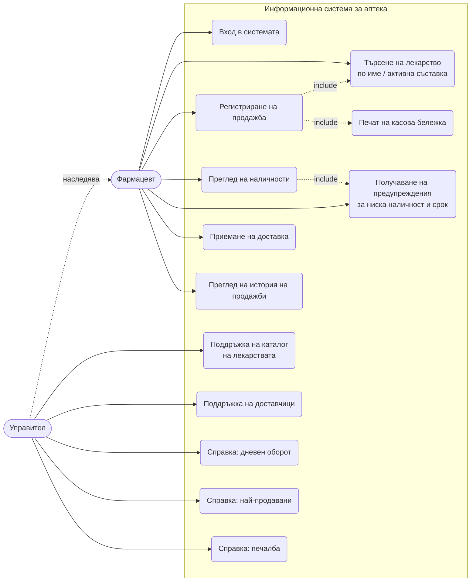

# Use Case диаграма

## Актьори

| Актьор | Описание |
|---|---|
| **Фармацевт** | Ежедневни операции: продажби, търсене, приемане на доставки, преглед на склада. |
| **Управител** | Всичко, което може фармацевтът, плюс поддръжка на каталога и достъп до справки за оборот и печалба. |

Управителят наследява правата на фармацевта (generalization).

## Описание на основния сценарий: "Регистриране на продажба"

| | |
|---|---|
| **Актьор** | Фармацевт |
| **Предусловие** | Потребителят е влязъл в системата. |
| **Резултат** | Записана продажба; наличностите са намалени; издадена е касова бележка. |

**Основен поток**

1. Фармацевтът въвежда част от името или активната съставка в полето за търсене.
2. Системата показва намерените лекарства с цена и текуща годна наличност.
3. Фармацевтът въвежда количество и добавя лекарството в сметката.
4. Системата изчислява автоматично сумата на реда и общата сума.
5. Стъпки 1–4 се повтарят за всички продукти.
6. Фармацевтът натиска „Приключи продажбата“.
7. Системата в **една транзакция**: заключва партидите, разпределя количествата по FEFO,
   записва продажбата и артикулите, намалява наличностите и записва движенията.
8. Системата показва касова бележка.

**Алтернативни потоци**

- **3а. Недостатъчна наличност** — системата отказва продажбата със съобщение колко
  броя са налични; нищо не се записва.
- **7а. Наличността е променена от друг касиер междувременно** — транзакцията се отменя
  изцяло и системата приканва да се опита отново.
- **2а. Партидата е с изтекъл срок** — не се предлага за продажба.
