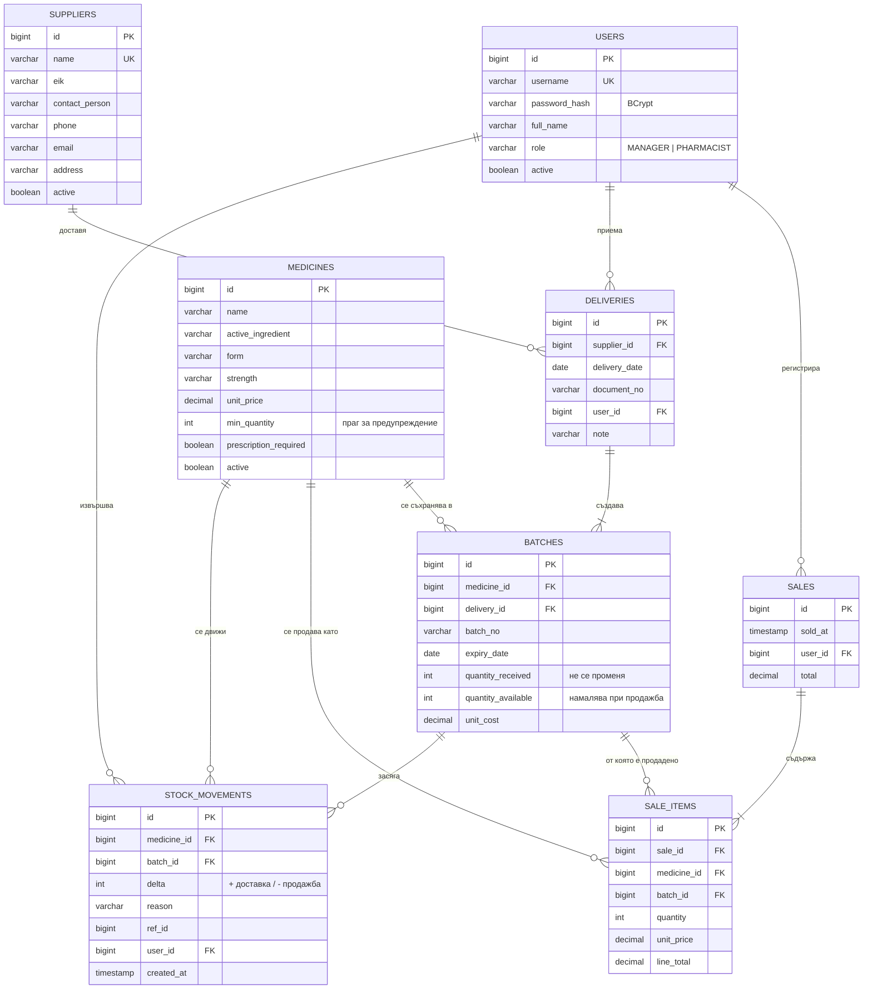

# ER диаграма на базата данни

## Защо наличността се води по партиди

Заданието изисква лекарството да има „налично количество“ и „срок на годност“.
На практика **две доставки на едно и също лекарство имат различни срокове**, затова
срокът е свойство на партидата, а не на лекарството.

Наличността на едно лекарство е сборът от наличните количества на неговите
**неизтекли** партиди. Тя се изчислява със заявка (`StockRepository`), а не се
дублира като колона — така не може да се разсинхронизира.

## Как се гарантира, че наличностите не се разминават

| Механизъм | Къде | Какво предотвратява |
|---|---|---|
| Една транзакция за цялата продажба | `SaleService.checkout` | Частичен запис при грешка по средата |
| `SELECT ... FOR UPDATE` върху партидите | `BatchRepository.findForUpdate` | Две едновременни продажби на последните бройки |
| `UPDATE ... WHERE quantity_available >= ?` | `BatchRepository.decrease` | Записване на отрицателна наличност |
| `CHECK (quantity_available >= 0)` | `01_schema.sql` | Разминаване дори при грешка в кода |
| `CHECK (quantity_available <= quantity_received)` | `01_schema.sql` | „Връщане“ на повече, отколкото е доставено |
| Таблица `stock_movements` | при всяка промяна | Невъзможност да се обоснове наличността |

Сверката „сборът на движенията = текущата наличност“ се проверява автоматично
от теста `movementsReconcileWithStock`.
