# Класова диаграма и архитектура

## Слоеве

```
Браузър
   │  HTTP (Thymeleaf шаблони)
   ▼
web/          контролери - приемат заявки, валидират вход, избират изглед
   ▼
service/      бизнес логика + ГРАНИЦА НА ТРАНЗАКЦИЯТА (@Transactional)
   ▼
repository/   SQL чрез JdbcTemplate, само подготвени заявки (PreparedStatement)
   ▼
MySQL
```

`logic/` стои отстрани: чисти класове без база и без Spring, затова се тестват
директно с модулни тестове.

## Основни класове

```mermaid
classDiagram
    class SaleService {
        +checkout(Cart, long userId) long
        +recentSales(int) List~Sale~
    }
    class DeliveryService {
        +receive(Delivery, long userId) long
    }
    class AlertService {
        +lowStock() List~Alert~
        +expiringSoon() List~Alert~
        +expired() List~Alert~
    }
    class FefoAllocator {
        <<utility>>
        +allocate(List~Batch~, int, LocalDate, String) List~BatchAllocation~
        +sellableQuantity(List~Batch~, LocalDate) int
    }
    class ExpiryPolicy {
        -int warningDays
        +isExpired(LocalDate, LocalDate) boolean
        +isExpiringSoon(LocalDate, LocalDate) boolean
    }

    class Cart {
        -List~CartLine~ lines
        +add(long, String, BigDecimal, int)
        +getTotal() BigDecimal
    }
    class CartLine {
        -long medicineId
        -BigDecimal unitPrice
        -int quantity
        +getLineTotal() BigDecimal
    }
    class Medicine {
        -Long id
        -String name
        -String activeIngredient
        -BigDecimal unitPrice
        -int minQuantity
    }
    class Batch {
        -Long id
        -LocalDate expiryDate
        -int quantityReceived
        -int quantityAvailable
        +isExpired(LocalDate) boolean
    }
    class MedicineStock {
        -int sellableQuantity
        -int expiredQuantity
        +isLowStock() boolean
    }
    class Sale {
        -Long id
        -BigDecimal total
        -List~SaleItem~ items
    }
    class Delivery {
        -Long id
        -LocalDate deliveryDate
        -List~DeliveryLine~ lines
    }

    class BatchRepository {
        +findForUpdate(long) List~Batch~
        +decrease(long, int) int
    }
    class SaleRepository
    class StockRepository
    class StockMovementRepository

    SaleService ..> FefoAllocator : използва
    SaleService ..> Cart
    SaleService --> BatchRepository
    SaleService --> SaleRepository
    SaleService --> StockMovementRepository
    DeliveryService --> BatchRepository
    DeliveryService --> StockMovementRepository
    AlertService ..> ExpiryPolicy
    AlertService --> StockRepository

    Cart "1" *-- "0..*" CartLine
    Sale "1" *-- "1..*" SaleItem
    Delivery "1" *-- "1..*" DeliveryLine
    MedicineStock --> Medicine
    FefoAllocator ..> Batch
```



## Ключово решение: FEFO разпределението е чист клас

`FefoAllocator` не познава базата данни и получава днешната дата като аргумент.
Затова цялата логика „коя партида се продава първа“ се тества с обикновени
модулни тестове, без да се вдига Spring или база — вж. `FefoAllocatorTest`.

Сервизът остава тънък: заключва партидите, пита `FefoAllocator` какво да направи
и записва резултата.
